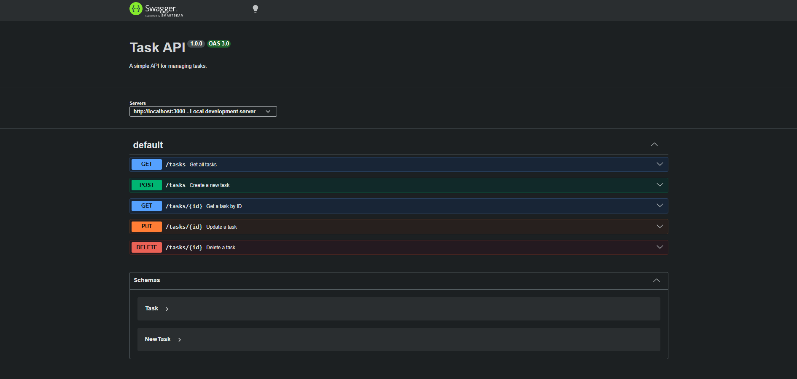

## Setup
1. Clone the repo
2. Run `npm install` and it will install all the requirements
3. After that, run `node index.js` and the server should start at http://localhost:3000/


| Method | Endpoint      | Description              |  Status                                                  |
| ------ | ------------- | ------------------------ | -------------------------------------------------------- |
| GET    | `/tasks`      | Returns all tasks        | `200 OK`                                                 |
| GET    | `/tasks/{id}` | Returns a task by ID     | `200 OK`                                                 |
| POST   | `/tasks`      | Creates a new task       | `201 Created`                                            |
| PUT    | `/tasks/{id}` | Updates an existing task | `200 OK`                                                 |
| DELETE | `/tasks/{id}` | Deletes a task by ID     | `200 OK`                                                 |


## Test
Run the following curl in a terminal:
```
curl -i -X PUT http://localhost:3000/tasks/2 ^
-H "Content-Type: application/json" ^
-d "{\"title\":\"Wash clothes\",\"done\":false}"
```

Output:
```
Content-Type: application/json; charset=utf-8
HTTP/1.1 200 OK

{
    "id": 2,
    "title": "Wash clothes",
    "done": false
}
```

## SwaggerUI
